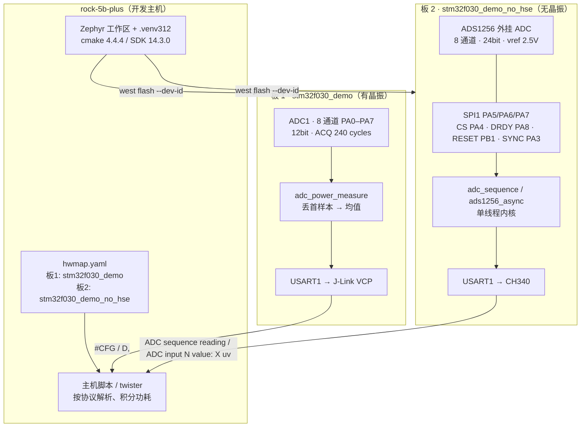

# 发布说明：STM32F030 双板开发环境与实现

> 分支 **`board-no-hse`**（基于上游 `main` `25206336e4f`，4 个提交）
> 目标硬件：两块 STM32F030F4P6（16 KB flash / 4 KB RAM）
> 每一条数字都来自 `west build` 输出或真机串口抓取，不是估算。

## 1. 这套环境解决什么问题

一台 RK3588 主机（`rock-5b-plus`）通过 USB 同时挂着两块 STM32F030 板子，一块用片上 ADC 做 8 通道采样，一块外挂 ADS1256 做 24 位高精度采样。整套环境要回答三个问题：

1. **能不能编译**：Zephyr 工作区、Python、CMake、SDK 版本互相咬合；
2. **能不能上板**：两块板各自的烧写通道与控制台串口不能搞混；
3. **装不装得下**：16 KB flash 是硬约束，每一千字节都要说清来路。

## 2. 开发环境

| 组成 | 版本/路径 | 备注 |
|---|---|---|
| 工作区 | `/mnt/raid1/shared/zephyrproject` | `zephyr` 仓库 + west 模块 |
| Python | `.venv312` = **3.12.14** | 上游 `PYTHON_MINIMUM_REQUIRED 3.12`，旧的 3.11 venv 在 configure 阶段就被拒 |
| CMake / Ninja | 4.4.4 / 1.13.2（装在 `.venv312`） | 系统 cmake 3.25.1 低于要求的 3.28 |
| Zephyr SDK | `/mnt/raid1/shared/zephyr-sdk` | `arm-zephyr-eabi` 14.3.0，**每次都要手动 export** |
| HAL 模块 | `modules/hal_stm32` @ `c9550199` | 新版自己实现了 `STM32CUBE_SOC_NAME_OVERRIDE`（x4 → HAL 层的 x6） |
| 网络 | SOCKS5 `192.168.2.6:1080` | pip/uv 用 `ALL_PROXY=socks5h://…`；git 走 SSH |
| twister 依赖 | `requirements-build-test.txt` | `natsort`/`junitparser` 缺了连 `--list` 都跑不起来 |

### 两块板与串口的对应（勿张冠李戴）

| 板 | J-Link id（`--dev-id`） | 控制台串口 | 用途 |
|---|---|---|---|
| 板 1 | `000069610657` | `usb-SEGGER_…000069610657-if00` → `ttyACM0` | 片上 ADC，跑 `adc_power_measure`（`#CFG` + `D,` 协议）|
| 板 2 | `000069610517` | `usb-1a86_USB_Serial-if00-port0` → `ttyUSB0` | 外挂 ADS1256；**无 HSE 晶振**；J-Link 自己的 VCP（`ttyACM1`）不要拿来收数据 |

twister 硬件图：`/mnt/raid1/shared/zephyrproject/hwmap.yaml`，板 2 的 platform 是 `stm32f030_demo_no_hse`。`runner: jlink` 时 twister 会把 `id` 转成 `west flash --dev-id`，两块 J-Link 靠它区分。

## 3. 系统框图



单线程内核（`CONFIG_MULTITHREADING=n`）是两块板共用的底层改造——没有它，板 2 的镜像装不进 16 KB。

## 4. 实现内容（对应 4 个提交）

### 4.1 `samples: adc: run adc_sequence on the external-ADC board`

把 power_shield 分支的 `adc_sequence` 支持移植到当前树：

- 板级 `.conf` / `.overlay`：PA0 单通道、12 bit、内部 3.3 V 参考、每序列 10 点
- 补齐 `board.cmake` 的 **jlink runner**（上游只注册了 openstm32 与 stm32flash）
- 删掉板级 defconfig 里过时的 `CONFIG_SRAM_VECTOR_TABLE=n`——新版 F0 SoC 已默认 `y`，两者矛盾会让**每个构建**都停在 Kconfig warning
- sample 补 `#include <stdio.h>`（minimal libc 的 printf 需要显式声明）
- ADC 时钟/预分频迁到 `adc1_common`（上游已把 STM32 ADC 拆成 common + 实例节点）

### 4.2 `boards: others: add stm32f030_demo_no_hse variant`

**这是本轮最关键的一次诊断。** 板 2 烧进镜像后**完全没输出**，也不报错。用 J-Link halt 读 PC → `addr2line`：

```
PC = 0x08000E0E -> set_up_fixed_clock_sources()
   drivers/clock_control/clock_stm32_ll_common.c:937
       LL_RCC_HSE_Enable();
       while (LL_RCC_HSE_IsReady() != 1) { }   ← 死在这里
```

板 2 **没焊 8 MHz HSE 晶振**，而基础板 DTS 写着 `&clk_hse status="okay"`。于是「没有晶振」被建模成板级属性：

| 与基础板的差别 | 值 |
|---|---|
| `&clk_hse` | `status = "disabled"` |
| `&pll` | `mul = <12>`，`clocks = <&clk_hsi>`（HSI 8 MHz → PLL 输入 HSI/2 = 4 MHz → **48 MHz**，与晶振版同频）|
| `&spi1` + `ads1256: adc@0` | 见 4.4 |

其余（SoC、UART 引脚、115200、runners）与基础板一致，并附 `doc/index.rst` 说明来龙去脉。

### 4.3 `kernel: add single-thread implementations`

`CONFIG_MULTITHREADING=n` 时内核没有信号量/队列/工作队列，而 ADC 与 SPI 驱动都要 `k_sem_take` → 链接失败：

```
undefined reference to `z_impl_k_sem_take'
```

补齐 10 个 `kernel/*_single.c`（queue / sem / mutex / sched / msg_q / stack / condvar / work / mailbox / system_work_q，共 1451 行），并在 `kernel/CMakeLists.txt` 的 `else() # CONFIG_MULTITHREADING` 分支用**新宏 `kernel_sources()`** 注册。

还修了 `drivers/spi/spi_context.h`：`SPI_CONTEXT_INIT_LOCK/SYNC` 原来无条件用 `Z_SEM_INITIALIZER`，单线程下**所有嵌入 `spi_context` 的驱动都编译不过**。改成按 `CONFIG_MULTITHREADING` 分叉，用原子标志代替信号量，并补一个 `fake_sync` 字段（两个宏不能都初始化同一个 `ready`）。

**收益（adc_sequence）：15596 B → 13340 B（81.42%）**，即单线程内核值约 2.2 KB。

### 4.4 `drivers: adc: add TI ADS1256 and its async sample`

- `drivers/adc/adc_ads1256.c`（620 行，阻塞式 `spi_transceive_dt` / `spi_write_dt`）+ `Kconfig.ads1256` + `ti,ads1256.yaml` + 两个 header，注册进 main 的 `zephyr-keep-sorted` 列表（插在 `ADS1220` 之后）
- **API 漂移**：`SPI_DT_SPEC_INST_GET(n, op, 0)` 在当前 main 只接受 **2 个参数**（编译期即报错）
- **接线归板 DTS**：SPI1 SCK PA5 / MISO PA6 / MOSI PA7、CS PA4、DRDY PA8、RESET PB1、SYNC PA3；sample 只留 `adc0 = &ads1256`
- 该镜像必须 `MULTITHREADING=n` 才装得下

## 5. 代码大小实测

### 最终尺寸

| 镜像 | FLASH | RAM |
|---|---|---|
| `adc_sequence`（多线程） | 15596 B (95.19%) | 3296 B (80.47%) |
| `adc_sequence`（单线程） | **13340 B (81.42%)** | 2784 B (67.97%) |
| `ads1256_async`（单线程） | **16188 B (98.80%)** | 2952 B (72.07%) |

### 那批「省的开关」现在全是空转

逐个实测（在 ADS1256 镜像上）：

| 开关 | 实测 | 为什么没效果 |
|---|---|---|
| `CONFIG_SPI_STM32_INTERRUPT=n` | 16188 → 16188 B | 本来就是 off |
| `CONFIG_NUM_PREEMPT_PRIORITIES=0` | 16188 → 16188 B | 单线程下本来就是 0 |
| `CONFIG_CORTEX_M_FAULT_FULL_PROCESS=n` | 不值得做 | LTO 已把故障路径裁到 **262 B**（`z_arm_fault` 256 B）|
| `CONFIG_MINIMAL_LIBC_LL_PRINTF=y` | 16188 → 16188 B | 只影响 libc `printf`；sample 用 `printk` |

这些开关在「旧 main + 无 LTO」时代有用，现在被 linker 提前做掉了。

### 真实的字节构成（ADS1256 镜像，按符号聚合）

| 占比 | 大小 | 归属 |
|---|---|---|
| 35.7% | 5344 B | STM32 驱动（`spi_stm32_transceive_sync` 1336、`uart_stm32_*` 668、gpio/pinctrl/clock）|
| 27.1% | 4052 B | 零散小符号与常量 |
| 13.8% | 2058 B | 内核 + arch |
| 12.8% | 1918 B | ADC（ADS1256 1048 + adc_context 572）|
| 7.5% | 1126 B | libc / printk |
| 2.7% | 406 B | device 框架 |
| 0.4% | 56 B | STM32Cube HAL |

没有白占的。要再省只能砍功能，不是调开关。

## 6. 真机验证记录

### 板 2 · adc_sequence

```
# west build -p always -b stm32f030_demo_no_hse samples/drivers/adc/adc_sequence
FLASH 15596 B (95.19%)   RAM 3296 B (80.47%)     exit 0

# west flash --runner jlink --dev-id 69610517
reset after flashing requested                    exit 0

# CH340 @115200
ADC sequence reading [0]:
- adc@40012400, channel 0, 10 sequence samples:
- - 0 = 0mV ... - - 2 = 1mV
ADC sequence reading [1]:
- adc@40012400, channel 0, 10 sequence samples:
- - 4095 = 3299mV  (×10)
```

### 板 2 · ads1256_async

```
FLASH 16188 B (98.80%)   RAM 2952 B (72.07%)     exit 0

# CH340 @115200
Starting ADC
ADC input 0 value: 0 uvADC input 1 value: 0 uv ... ADC input 7 value: 0 uv
```

`device_is_ready()` 通过说明 SPI 通信正常（驱动 init 会读状态寄存器），`0 uv` 是 8 路输入真的接地。

### 镜像一致性

烧写后用 J-Link 回读 flash 头部与本地镜像逐字节比对，两次都一致（`e0 08 00 20 …` = adc_sequence，`88 07 00 20 …` = ads1256）。

## 7. 使用方法

```bash
export PATH="$HOME/.local/bin:$PATH"                     # uv
cd /mnt/raid1/shared/zephyrproject && source .venv312/bin/activate
export ZEPHYR_SDK_INSTALL_DIR=/mnt/raid1/shared/zephyr-sdk
cd zephyr

# 板 1（片上 ADC）
west build -p always -b stm32f030_demo samples/drivers/adc/adc_power_measure
west flash --runner jlink --dev-id 000069610657

# 板 2（外挂 ADS1256，无晶振）
west build -p always -b stm32f030_demo_no_hse samples/drivers/adc/adc_sequence
west flash --runner jlink --dev-id 000069610517

# 两块板一起跑 twister
west twister --hardware-map /mnt/raid1/shared/zephyrproject/hwmap.yaml \
             --device-testing -T samples/drivers/adc
```

串口两边都是 **115200 8N1**；抓取时先开 `cat` 再复位板子（串口无缓冲）。

## 8. 已知限制与后续

- **ADS1256 镜像只剩 196 B（1.2%）**。config 类开关已榨干（见 §5）；再往前只能砍功能，例如去掉异步 ADC 依赖或不用 `printk`。
- **RAM 是唯一还宽松的地方**：三个 1024 B 的栈（main / ISR / system_workqueue）在单线程下可降到 512，RAM 能从 72% 压到约 50%。
- **`fault.c` 裁剪不做**：分支那版 `fault.c` 基于旧上游，整份拿来会回退约 500 行新代码；而按当前构建实测故障路径只剩 262 B，收益接近零。
- 与 `lc_power_shield` 分支是**两条并行线**（内部 ADC / 外挂 ADC），互不包含，尚未合并。
- 开发机上 `git push` 走 HTTPS 会因缺凭据失败，远程操作统一用 SSH；`west update` 需要单独把模块 remote 改成 SSH。

---

本文件描述的功能与数字均已在本机实测；对应实现见分支 `board-no-hse` 的 4 个提交。
