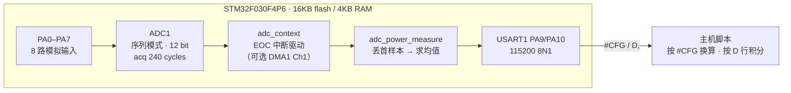

# 发布说明：STM32F030 多通道 ADC 采样 / 功耗测量系统

> 目标平台 `stm32f030_demo`（STM32F030F4P6，**16 KB flash / 4 KB RAM**）
> Sample：`samples/drivers/adc/adc_power_measure` · 分支 `lc_power_shield`

## 1. 概述

在一片只有 16 KB flash 的 Cortex-M0 上，把「8 通道 ADC 轮流采样 → 平均值 → 机器可读串口输出」这条链路做到可用，并且**把每一次取舍都量化**：不是「应该能放下」，而是把 flash 用到 91.31% 时还算得清每个字节从哪来。

三条主线：

1. **采样链路**：ADC1 序列模式覆盖 PA0–PA7，每通道 5 次采样、丢首个样本后取均值，单次序列就在中断里搬完 8 个通道。
2. **输出协议**：开机一行 `#CFG` 说明如何换算，之后每次触发一行 `D,<时间戳>,<8 个通道>`，脚本直接消费、按时间积分功耗。
3. **驱动修复**：让上面两条真的能跑 —— overrun、buffer 位宽、中断表、上游 DT 结构变更，四个坑逐个有现象、有证据、有修法。

## 2. 系统框图



```
  PA0..PA7 ──▶ ADC1（8 rank 序列, 12bit, ACQ=240 cycles）
                 │ EOC 每转换一次
                 ▼
            adc_context（信号量 + 中断）            ← 无 DMA 时走这条
                 │ 8 个 EOC → 序列完成
                 ▼
        channel_reading[5][8] ──▶ 丢首个样本 ──▶ 每通道均值
                 │
                 ▼
        printf("#CFG,...")  一次
        printf("D,%u,%d,...") 每次响应一个字符
                 │
                 ▼
        USART1 @115200 ──▶ 主机脚本 ──▶ 电压 / 电流 / 功耗
```

选择「中断驱动 + 固件内平均」而不是继续加 DMA，理由在 §5、§6 里用实测数字说明。

## 3. 采样链路设计

| 参数 | 取值 | 说明 |
|---|---|---|
| 通道 | PA0–PA7，8 路 | 由 devicetree 的 `channel@0..7` 子节点描述，代码里没有硬编码通道号 |
| 分辨率 | 12 bit | `CONFIG_SEQUENCE_RESOLUTION=12` |
| 参考电压 | 1250 mV | 内部参考，`zephyr,vref-mv`，每个通道各自可配 |
| 采样时间 | **240 ADC 周期** | 默认 1.5 周期会 overrun（§7.1） |
| 序列样本数 | 5 | `CONFIG_SEQUENCE_SAMPLES=5` |
| 参与平均 | **4**（丢首个） | 首个样本受采样保持电容残留电荷影响，见 §7.5 |
| buffer 元素 | **16 bit** | `adc_data_size_t` 在 STM32F0 上是 `uint16_t`，不能用 32 位配置 |
| ADC 时钟 | PCLK/4 = 12 MHz | F0 只有 PCLK/2 与 PCLK/4 两档 |

## 4. 输出协议与实测 log

开机一次：

```
#CFG,ch=8,res=12,ref_mv=1250,seq=5,avg=4
```

| 字段 | 含义 |
|---|---|
| `ch` | 通道数 |
| `res` | ADC 位数，值域 `1 << res` |
| `ref_mv` | 参考电压（mV） |
| `seq` | ADC 实际转换几个点 |
| `avg` | 真正参与平均的点数（`seq` 减掉被丢弃的首个） |

每次收到任意字符，回一行：

```
D,<uptime_ms>,<ch0>,<ch1>,...,<ch7>
```

真机抓取（每秒触发一次）：

```
#CFG,ch=8,res=12,ref_mv=1250,seq=5,avg=4
D,4337,2743,2303,2049,2073,1634,2022,2174,2046
D,5342,2284,2130,2038,2193,1629,2022,2223,2053
D,6347,2181,2124,2044,2134,1632,2027,2229,2057
```

- 时间戳取序列**完成时刻**的 `k_uptime_get()`，所以采样时刻不受串口往返延迟影响（上例间隔 1005 / 1005 ms，与实际 1 s 触发吻合）
- 换算：`mV = raw * ref_mv / (1 << res)`
- 读失败：`#ERR,<errno>` 替代 `D` 行，脚本不会把错误当数据

## 5. 代码大小：算清每一个字节

最终尺寸（`west build -p always -b stm32f030_demo`，16 KB flash / 4 KB RAM）：

```
FLASH: 14960 B / 16 KB = 91.31%
RAM:    2544 B /  4 KB = 62.11%
```

关键决策与代价（全部在本板实测）：

| 决策 | 效果 | 依据 |
|---|---|---|
| `CONFIG_LTO=y` + `CONFIG_ISR_TABLES_LOCAL_DECLARATION=y` | **−1.46 KB**（唯一让本板放得下的原因） | 关掉任一：16756 B / 16752 B，**溢出 372 B** |
| 输出改机器可读（一行 8 个数） | **−272 B** | 冗长的逐样本输出比 `,` 分隔的数字贵得多 |
| 丢弃首样本后再平均 | +0 B（只是循环起点 +1） | 见 §7.5 |
| `CONFIG_SEQUENCE_SAMPLES` 1 → 5 | +0 B flash（RAM +64 B） | 只影响 buffer 尺寸 |
| 打开 `CONFIG_ADC_LOG_LEVEL=4` 排查 | **+784 B，直接溢出** | 所以转用单字符 `printk` 插桩 |
| 使能 DMA | **+616 B** | 装不下，见 §6 |

两个反直觉结论，写在这里避免后来者重犯：

1. **`LTO` 与 `ISR_TABLES_LOCAL_DECLARATION` 不可拆**。`Kconfig.zephyr` 里 `LTO depends on ... || ISR_TABLES_LOCAL_DECLARATION`，ARM 上 `GEN_IRQ_VECTOR_TABLE` 恒为 y，所以关掉 local declaration 就同时失去 LTO —— 两个 1.4 KB 一起消失。看到 flash 紧张先关 LTO 是**反效果**。
2. **`GEN_SW_ISR_TABLE` 不是省空间的开关**。它是功能开关：`DYNAMIC_INTERRUPTS=n` 时若它为 `n`，`IRQ_CONNECT` 不生效、中断表里没有条目、ADC 中断永不派发。

## 6. DMA 模式：能跑，但要付 616 字节

DMA 路径已实现并**在板上验证通过**：即使把采样时间改回最短的默认值（也就是无 DMA 时会 overrun 的那份配置），8 通道仍然全部正确、连续读取稳定。

```dts
&dma1 {
	status = "okay";
};

&adc1 {
	dmas = <&dma1 1 (STM32_DMA_PERIPH_TO_MEMORY | STM32_DMA_PERIPH_NO_INC
			| STM32_DMA_MEM_INC | STM32_DMA_PERIPH_16BITS
			| STM32_DMA_MEM_16BITS | STM32_DMA_PRIORITY_HIGH)>;
};
```

要点：**必须 16 位**（源是 ADC->DR、目的是 `uint16_t` buffer）；F0 上 ADC 的 DMA 请求固定走 **DMA1 channel 1**；v2bis 不需要 slot cell。

实测读数（默认采样时间 + DMA）：

```
R0: 696 1697 1758 2028 1552 1987 2152 1808
R1: 744 1680 1728 1991 1544 1825 1999 1904
R2: 729 1670 1724 1975 1527 1598 1825 1802
```

**代价与结论**：DMA 要吃 ~616 B，而本板当时只剩 ~1 KB。把所有能省的都省掉（`LOG=n`、`UART_INTERRUPT_DRIVEN=n`、`PICOLIBC=n` 各几乎不省；输出压成一行 −400 B；去掉特性打印分支 −200 B）才勉强到 **16288 B（99.41%），只剩 96 B**。

因此**发布默认配置是无 DMA + 240 周期采样时间**；DMA 版本作为可选配置保留在文档里，适合可接受的代价或更大 flash 的型号。`CONFIG_GPIO` 不能关（`pinctrl_stm32.c` 直接调 `gpio_stm32_configure`）。

## 7. 驱动与框架修复

### 7.1 多通道序列 overrun（现象：打印表头后卡死）

默认 `ADC_ACQ_TIME_DEFAULT`（1.5 周期）在 ADCCLK = 12 MHz 下一路转换约 1.2 µs，EOC 中断来不及读 DR → overrun → **序列在第 1 个通道后中断**，而 `adc_read()` 还在等剩余 7 个 EOC，永久阻塞。

诊断过程：ISR 里插桩，`[S]` 打出、`i` 只出现一次 → 确认「只发生了一次转换」；打印 `n=8 chsel=0xff cfgr1=0` 排除配置错误；只选 1 个通道可正常返回 → 锁定在多通道 + 无 DMA 路径。

**修法**：`zephyr,acquisition-time = <ADC_ACQ_TIME(ADC_ACQ_TIME_TICKS, 240)>`（必须精确命中 DTS 表 `<2 8 14 29 42 56 72 240>`，写 239 会 `-EINVAL`）。

### 7.2 buffer 位宽错配（现象：读数是天文数字）

`CONFIG_SEQUENCE_32BITS_REGISTERS=y` 让 sample 按 `uint32_t` 读 buffer，而 STM32F0 上 `adc_data_size_t` 是 `uint16_t`（`drivers/adc/adc_stm32.c:168`，只有 STM32N6 用 32 位）。驱动按 16 位连续写、sample 按 32 位读 → 布局错位，读到 `149621369`（= 0x08EB1B79）这种值，且**不报任何错**。

**修法**：`# CONFIG_SEQUENCE_32BITS_REGISTERS is not set`。

### 7.3 中断表未生成（现象：ADC 中断永不派发）

`CONFIG_GEN_SW_ISR_TABLE=n` 时 `IRQ_CONNECT` 不生效。上游已有修复（`fix isr table issue`），本分支沿用并要求 `CONFIG_GEN_SW_ISR_TABLE=y`。

排查要点：向量表 IRQ12 入口确实指向 `adc_stm32_isr_12`，`sw_isr_table` 条目在位 —— 这排除了「中断没接上」，把问题推向 overrun。

### 7.4 上游重构 ADC devicetree（现象：DT 直接拒绝 + 链接失败）

上游把 STM32 ADC 拆成 **common 块 + 实例节点**。旧写法把 `st,adc-clock-source` 放在实例节点上，会被 DT 拒绝：

```
devicetree error: 'st,adc-clock-source' appears in /soc/adc@40012400/adc@40012400
but is not declared in 'properties:'
```

而 common 块默认 `disabled`，导致 ADC 设备没被实例化：`undefined reference to __device_dts_ord_19`。

**修法**：时钟/预分频移到 `&adc1_common` 并使能它，实例节点只保留 reg/interrupts/pinctrl/status/channels。

### 7.5 首样本偏低（现象：第 1 个点明显掉下去）

浮空输入下同一通道 5 个原始码：

```
639 1310 1678 1937 2089
```

首个样本比稳态低约 980 码，直接平均会把结果拉低约 200 码（≈60 mV）。原因：采样保持电容仍带有上一通道的残留电荷。

**修法**：固件平均时丢弃首个样本（`CONFIG_SEQUENCE_DISCARD_FIRST=y`，`seq == 1` 时自动不丢）。同一序列内的对照显示，丢弃后均值抬高 100~220 码。接真实分压源（低阻）时后续样本会迅速收敛。

## 8. 实测记录汇总

```
构建：FLASH 14960 B (91.31%) / RAM 2544 B (62.11%)     exit 0
烧写：west flash --runner jlink                        exit 0（J-Link：Cortex-M0 r0p0）
串口：#CFG,ch=8,res=12,ref_mv=1250,seq=5,avg=4
      D,4337,2743,2303,2049,2073,1634,2022,2174,2046
      D,5342,2284,2130,2038,2193,1629,2022,2223,2053
      D,6347,2181,2124,2044,2134,1632,2027,2229,2057
```

- 8 通道全部给出合理电压，连续多次测量稳定
- 时间戳间隔与实际触发节拍（1 s）吻合，可作为功耗积分的时间基准
- 上位机（功率 harness）侧另有实现：探针按 `#CFG`/`D` 解析，`I = V / (shunt × gain)`，作为第二个 DUT（`duts[1]`）接入官方多 DUT 测试框架

## 9. 使用方法

```bash
# 构建与烧写（本板 openocd 是默认 runner，必须显式指定 jlink）
west build -p always -b stm32f030_demo samples/drivers/adc/adc_power_measure
west flash --runner jlink

# 串口：USART1 PA9/PA10 @115200 8N1
#   打开串口后再复位板子（串口无缓冲，先复位会抓到 0 字节）
#   发任意字符触发一次测量，发 '\r' 打印通道特性表
```

上位机最小消费逻辑：

```python
for line in serial_stream:
    line = line.strip()
    if line.startswith("#CFG,"):
        cfg = dict(kv.split("=") for kv in line[5:].split(","))
    elif line.startswith("D,"):
        f = line.split(",")
        t_ms, raw = int(f[1]), [int(v) for v in f[2:]]
        mv = [r * int(cfg["ref_mv"]) / (1 << int(cfg["res"])) for r in raw]
```

## 10. 已知限制

- **flash 余量 8.7%**（约 1.4 KB）：任何新增功能都要先看 size 报告
- **DMA 默认不开**：能跑但要 +616 B，见 §6
- **浮空输入时后续样本仍在爬升**：接真实分压源（低阻抗）才会收敛，测绝对电压前请确认末端样本一致
- 采样时间只能取 DTS 表里的离散值；F0 的 ADC 时钟只有 PCLK/2 与 PCLK/4

---

本文件描述的功能均已在本板实测；所有数字都是 `west build` / 串口抓取的真实输出，不是估算。
